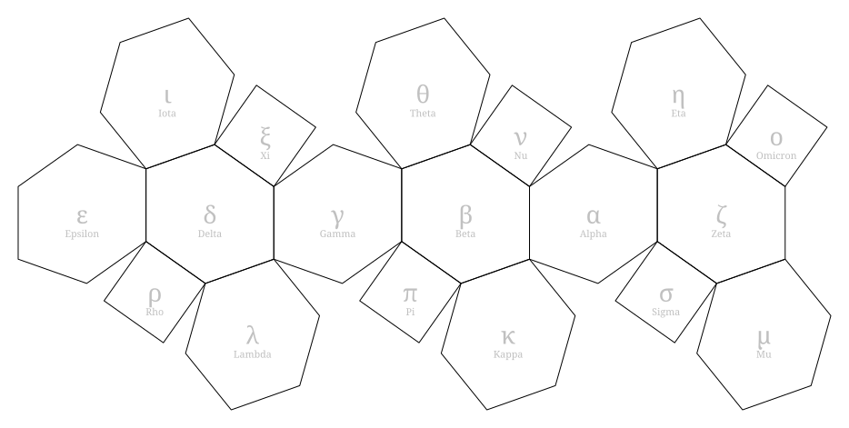

# RpgUtilities

Utilities for fantasy role-playing games.

## World map editor (in progress)

`map-editor/index.html` is a single-file hex map editor. It uses only native
browser JavaScript, with no frameworks, build step, or external files. Open it
directly in a browser, or serve the repository locally:

```
python3 -m http.server 8000
# then browse to http://localhost:8000/map-editor/index.html
```

The specification is [`prompt.md`](prompt.md), the implementation plan is
[`doc/map-editor-plan.md`](doc/map-editor-plan.md), and progress is tracked in
[`doc/map-editor-status.md`](doc/map-editor-status.md).

### Creating and opening maps

**New** creates an all-water global world or local rectangle. Global maps use an
even panel-hex count and regional L (36 mi) or XL (216 mi) hexes. Local maps take a
width, height and universal anchor for tile (0, 0), such as `Eta 187.1W 324.0N`.

| Local-map system | S | M | L | XL |
| --- | --- | --- | --- | --- |
| Regional | 1 mi | 6 mi | 36 mi | 216 mi |
| Local | 1 yd | 10 yd | 100 yd | 600 yd |

Regional anchors snap to their same-scale world lattice; the dialog previews the
result. Yard-scale anchors remain free. Local grids continue flat in the anchor
panel's frame, without wrapping at panel boundaries. All terrain and feature
tools work on both map kinds. **Fit all** and the minimap navigate either kind;
panel focus and net-view controls apply only to global maps.

**Open** accepts either kind of `.map.txt`, including the samples in
`tests/fixtures/`. **Save** (Ctrl+S) downloads a canonical text file. New maps start
unsaved and are autosaved even before their first edit. Canceling New or rejecting
its discard confirmation preserves the current map.

### Feature editing

Use **Path (O)** to draw a road, trail or river: choose its type, click **New path**,
then click tiles to extend it. Gaps follow the shortest connected tile path across
panel seams. **Escape** finishes the path. Select a path to edit its name/style,
insert or remove a point, split at an interior point, or join another path of the
same type. Joining keeps the selected path's name/style.

**Landmark (K)** places one landmark per tile; its type, name and notes are editable
in Properties. **Label (T)** adds text with per-label category, size, rotation and
offsets. Drag a selected label's white handle to move it or its yellow handle to
rotate it; Escape cancels the drag. **New label** allows multiple labels on a tile.
Label size and offsets use 48 units per hex height and scale with zoom.

**Select (V)** and **Erase (E)** have a target-layer selector. Overlapping features
can be selected individually using **Features on this tile** in Properties.
Hidden layers cannot be selected or erased. Delete/Backspace deletes the selected
visible feature. Each property change, path operation and completed label drag is
one undo step (Ctrl+Z; Ctrl+Y to redo). Changes are included in Save (Ctrl+S) and
browser autosave.

### SVG export

**Export SVG** downloads one selected global panel, north-up, or the entire local
map. Choose the output width (default 1600 px); height preserves the map's aspect
ratio. Layer options include terrain colours, smoothed shorelines, hex grid,
roads, trails, tapered rivers, landmarks, optional landmark names, and labels.
The initial visibility follows the canvas where applicable, but export settings
do not change the canvas.

The SVG is self-contained and deterministic, with transparent space outside the
map and where terrain colours are omitted. Regions preserve holes; panel edges
are clipped without inventing coastlines along the cut. Feature placement and
rotation follow the editor, including seam copies and partial tiles. Export
does **not** save the editable map, clear its unsaved indicator, or change undo
history; use Save for `.map.txt`. Terrain embellishments are milestone 11.

### Code layout

| Path | Purpose |
| --- | --- |
| `map-editor/index.html` | The editor. Each `<script data-module="Name">` block registers `globalThis.RpgMap.Name`. |
| `tests/*.test.cjs` | Unit tests (Node's built-in test runner, no npm packages). |
| `tests/_load.cjs` | Loads the DOM-free modules from `index.html` for the tests. |
| `tests/fixtures/*.map.txt` | Sample map files in the editor's save format. |
| `doc/file-format.md` | Specification of the `.map.txt` save format. |
| `tools/generate_map_projection.py` | Builds and validates the chamfered-cube world projection. |
| `doc/equilateral-chamfered-cube.{json,svg}` | Projection geometry (reference data for the editor) and a diagram of the unfolded net. |

Module blocks appear in dependency order. Blocks marked `data-dom="true"` use
the browser DOM and are skipped by `LoadModules`; all other blocks must be
DOM-free. Renderer contract tests load that module separately with canvas doubles;
browser smoke checks verify actual rendering and interaction. SVG tests also use
Python's standard-library XML parser when available; the browser checks parse
and render SVGs independently.

### Tests

Tested with Node.js 26. If Python 3.8+ is on the path, the tests also confirm
the projection exports are reproducible.

```
node --test tests/
```

### World projection

The global map is drawn on an unfolded equilateral chamfered cube: 12 hexagonal
and 6 square panels named after Greek letters. To regenerate or verify the
reference geometry:

```
python3 tools/generate_map_projection.py --labels          # write doc/ exports
python3 tools/generate_map_projection.py --labels --check  # verify they reproduce exactly
```


